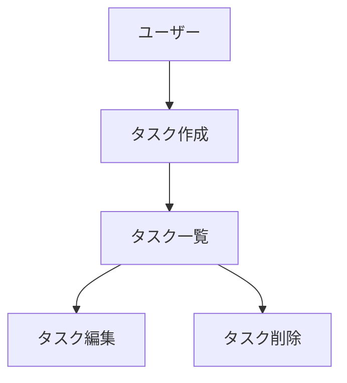

---
paths:
  - "doc/**"
---

# ドキュメント整備ルール

## 1. 永続的ドキュメント（`doc/persistent/`）

アプリケーション全体の「**何を作るか**」「**どう作るか**」を定義する恒久的なドキュメント。
アプリケーションの基本設計を記述します。
頻繁に更新されないため、大きな設計変更時のみ更新します。
プロジェクト全体の「北極星」として機能します。

- **product-requirements.md** - プロダクト要求定義書（「**何を作るか**」）
  - プロダクトビジョンと目的
  - ターゲットユーザーと課題・ニーズ
  - 主要な機能一覧
  - バッチ処理・Webhook 一覧（処理名・処理内容・対応機能のみ。実装方式・頻度は functional-design.md）
  - 画面一覧（画面名・対応機能・認証のみ。ルートパスは functional-design.md）
  - 成功の定義
  - ビジネス要件
  - ユーザーストーリー
  - 受け入れ条件
  - 機能要件（何ができるかのみ。実装方式は functional-design.md）
  - 非機能要件（パフォーマンス目標・セキュリティ要件のみ。技術スタック・可用性・スケーラビリティの実装方式は functional-design.md）

- **functional-design.md** - 機能設計書（「**どう作るか**」）
  - 技術スタック
  - システム構成図
  - 画面設計（ルートパス定義、レイアウト構成、画面遷移図）
  - データモデル定義（ER 図含む）
  - API 設計（GraphQL: Query/Mutation 一覧、REST: エンドポイント一覧）
  - Lambda 関数一覧
  - バッチ処理・Webhook 設計（実装方式、頻度、テーブル書き込みマトリクス）

### product-requirements.md と functional-design.md の分離基準

- **product-requirements.md** には技術固有の名称（Cognito、Stripe Checkout、Lambda 等）を書かない
- 「何が必要か」は product-requirements.md、「どう実現するか」は functional-design.md
- 両ドキュメントで同じ項目を参照する場合は ID（F-01、S-01、B-01、W-01 等）で紐づける

## 2. 作業単位のドキュメント（`doc/steering/[YYYYMMDD][連番]-[開発タイトル]/`）

特定の開発作業における「**今回何をするか**」を定義する一時的なステアリングファイル。
作業ごとに新しいディレクトリを作成します。
作業完了後は参照用として保持します。
変更の意図と経緯を記録する目的です。

- **plan.md** - タスク分解の計画ファイル
  - 全体の目的・スコープ
  - タスク一覧（見出し形式: `### task-NN-title` + 概要・依存関係）
  - 推奨実行順序

各タスクはサブディレクトリ `task-NN-title/` に以下の3ファイルを持つ：

- **requirements.html** - 今回のタスクの要求内容
  - 変更・追加する機能の説明
  - ユーザーストーリー
  - 受け入れ条件
  - 制約事項

- **design.html** - 変更内容の設計
  - 実装アプローチ
  - 変更するコンポーネント
  - データ構造の変更
  - 影響範囲の分析

- **tasklist.html** - タスクリスト
  - 具体的な実装タスク
  - タスクの進捗状況
  - 完了条件

### ステアリングディレクトリの命名規則

```
doc/steering/[YYYYMMDD][連番]-[開発タイトル]/
```

- 連番は 2 桁ゼロ埋め（01, 02, ...）。同日に複数作成する場合の実行順序を示す
- 同日に 1 件のみの場合も連番を付ける

**例：**

- `doc/steering/2025010301-initial-implementation/`
- `doc/steering/2025011501-add-tag-feature/`
- `doc/steering/2025012001-delete-sample-code/`
- `doc/steering/2025012002-add-user-model/`
- `doc/steering/2025012003-add-user-api/`

### タスクサブディレクトリの命名規則

```
task-[NN]-[タスクタイトル]/
```

- NN は 2 桁ゼロ埋め（01, 02, ...）。plan.md で定義した順序に対応する
- タスクタイトルはケバブケースで簡潔に記述する

**例：**

```
doc/steering/2025010301-initial-implementation/
  plan.md
  task-01-backend-api/
    requirements.html
    design.html
    tasklist.html
  task-02-frontend-ui/
    requirements.html
    design.html
    tasklist.html
```

### スリム化ルール（steering 3 ファイル共通）

steering ファイルは複数のサブエージェントから重複読み込みされるため、肥大化はトークンコスト・レビュー負荷を線形に押し上げる。以下のルールに従って **必要十分・重複なし** で記述する。

#### 全ファイル共通の禁止事項

- **コミットハッシュや過去経緯の引用は最大 1 行**（「コミット `xxx` で elk-api 統合済み」程度。背景説明を段落で再掲しない）
- **同じ情報を複数ファイルに書かない**（design.html にあるテーブル構造を tasklist.html にも貼らない、等）
- **コード例・型定義のコピーは禁止**。記載するのは「どの shared/models/\*.ts を作るか」のパスのみ。型の中身は実装時にコードで確認する
- **「後追い改修」セクションを残さない**。後追い改修は完了後に該当タスクを書き換え、フェーズ H / J / K のような追記でファイルを延ばさない

#### requirements.html（目安：100 行以下）

書く：

- 変更・追加する機能の 1〜3 行サマリ
- ユーザーストーリー（箇条書き 3〜7 件）
- 受け入れ条件（チェックリスト形式、定義用なのでチェック不要）
- 制約事項（既存制約や前提条件、3〜5 件）

書かない：

- 設計詳細（design.html の領分）
- ファイル一覧・関数一覧（tasklist.html の領分）
- product-requirements.md / functional-design.md からの長文引用（ID 参照のみで足りる）

#### design.html（目安：300 行以下）

書く：

- 実装アプローチ（箇条書き 3〜5 項目）
- 変更ファイル一覧テーブル（**パス / 役割を 1 行で**。役割は「○○の Repository」「○○の Service」程度に留める）
- データ構造の概要（フィールド名と型の表のみ。コード貼り付け禁止）
- 影響範囲の分析（変わる箇所と変わらない境界を 5 行以内で）

書かない：

- 既存実装の再説明（git log / コード本体を読めば足りる）
- 各ファイルの実装ロジック詳細（tasklist.html の領分でもなく、実装コードの領分）
- フェーズ分けの図表が複数（フェーズは tasklist.html で章立てに表現）
- 長文の方針説明（コミット参照 + 1 行で代替）

#### tasklist.html（目安：200 行以下）

書く：

- 進捗チェックリスト（フェーズごとに `### フェーズ A` / `- [ ]` で羅列）
- 1 タスク = 1 行（「○○ を作成」「○○ に case 追加」など動詞 + 対象パス）
- 完了条件（ファイル末尾に 3〜5 行で集約。`tsc --noEmit` エラー 0 など）

書かない：

- design.html と重複する記述（ファイルの内容、データ構造、依存関係の説明）
- サブ箇条書きでの実装詳細（「○○関数を作成」配下に引数仕様などを並べない）
- 各タスクごとの「完了条件」（最終 1 か所に集約）

#### 違反検出の目安

- ファイルが目安行数の 1.5 倍を超えたら **書き直しを検討**
- design.html と tasklist.html で同じ単語が 5 回以上出現するファイル一覧 / 関数一覧があれば重複している可能性が高い

## 図表・ダイアグラムの記載ルール

### 記載場所

設計図やダイアグラムは、関連する永続的ドキュメント内に直接記載します。
独立した diagrams フォルダは作成せず、手間を最小限に抑えます。

**配置例：**

- ER 図、データモデル図 → `functional-design.md` 内に記載
- ユースケース図 → `functional-design.md` または `product-requirements.md` 内に記載
- 画面遷移図、ワイヤフレーム → `functional-design.md` 内に記載
- システム構成図 → `functional-design.md` 内に記載

### 記述形式

1. **Mermaid 記法（推奨）**
   - Markdown に直接埋め込める
   - バージョン管理が容易
   - ツール不要で編集可能



2. **ASCII アート**
   - シンプルな図表に使用
   - テキストエディタで編集可能

```
┌─────────────┐
│   Header    │
└─────────────┘
       │
       ↓
┌─────────────┐
│  Task List  │
└─────────────┘
```

3. **画像ファイル（必要な場合のみ）**
   - 複雑なワイヤフレームやモックアップ
   - `doc/persistent/images/` フォルダに配置
   - PNG または SVG 形式を推奨

### 図表の更新

- 設計変更時は対応する図表も同時に更新
- 図表とコードの乖離を防ぐ

## 注意事項

- ドキュメントの作成・更新は段階的に行い、各段階で承認を得る
- `doc/steering/` のディレクトリ名は日付と開発タイトルで明確に識別できるようにする
- 永続的ドキュメントと作業単位のドキュメントを混同しない
- 図表は必要最小限に留め、メンテナンスコストを抑える
