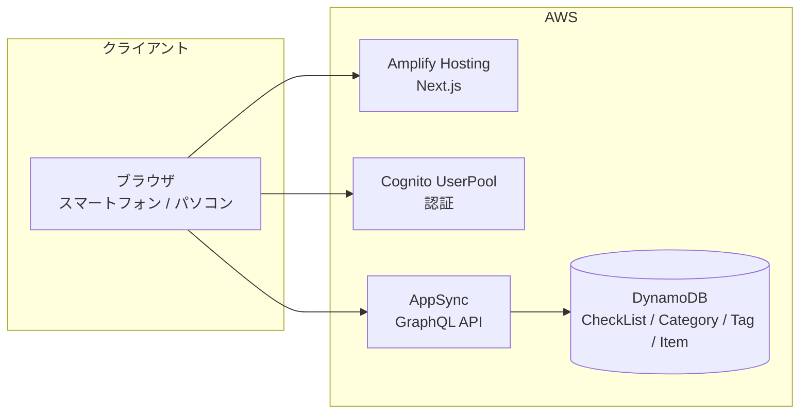
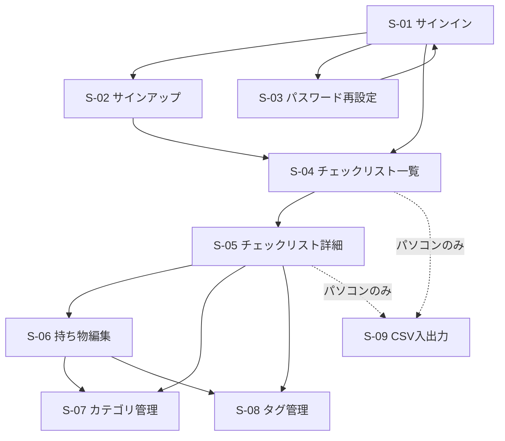
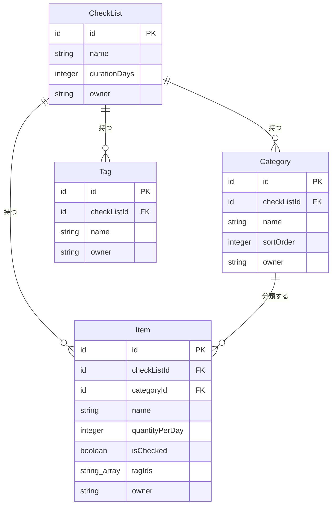

# CheckList 機能設計書

本書は `product-requirements.md`（「何を作るか」）に対する「どう作るか」を定義する。機能ID（F-NN）・画面ID（S-NN）・受け入れ条件ID（AC-NN）は同書を参照する。

## 技術スタック

| レイヤー           | 技術                                                       |
| ------------------ | ---------------------------------------------------------- |
| フロントエンド     | Next.js 16（App Router）/ React 19 / TypeScript 5           |
| UI                 | Tailwind CSS 4 / shadcn/ui（Radix UI）/ lucide-react        |
| 認証               | Amazon Cognito UserPool（Amplify Auth）                     |
| API                | AWS AppSync（GraphQL・Amplify Data）                        |
| データストア       | Amazon DynamoDB（Amplify Data が生成）                      |
| IaC / デプロイ     | AWS Amplify Gen 2（CDK）                                    |
| ホスティング       | AWS Amplify Hosting                                         |

テンプレート（Amplify-G2-Template）の構成をそのまま用い、新規の依存パッケージは追加しない。CSVの解析・生成は外部ライブラリを使わず自前実装とする（列数5・区切り文字固定のため）。

## システム構成図

**Lambda関数は定義しない。** 一括処理（一括リセット・一括削除・複製・CSV取り込み）はいずれも複数レコードを順に書き換えるループであり、Lambdaに置いてもAppSync経由の呼び出し回数は変わらない。150件規模ではコールドスタートの分だけ不利になるため、フロントエンドのService層から同時実行数を制限して発行する。

## アーキテクチャレイヤー

`architecture.md` のレイヤー構成に従う。

### フロントエンド

**Component → Hook → Service → Repository → AppSync**

| レイヤー   | 配置先                  | 本プロダクトでの主な責務                                     |
| ---------- | ----------------------- | ------------------------------------------------------------ |
| Component  | `src/app/components/`   | 画面描画・入力イベント。ロジックを持たない                   |
| Hook       | `src/app/hooks/`        | 画面単位の状態保持、Serviceの呼び出し、楽観的更新の制御      |
| Service    | `src/app/services/`     | 数量計算・タグ絞り込み・CSVの生成と解析・入力値の検証        |
| Repository | `src/app/repositories/` | Amplify Data Clientの呼び出しのみ                            |

タグ絞り込み（F-06）と数量計算（F-09）は、詳細画面が保持済みの持ち物配列に対するクライアント側の処理としてServiceに置く。絞り込みのたびにAPIを呼ばない。

### バックエンド

Lambda関数を持たないため、`amplify/` はリソース定義のみとなる。

| 配置先                       | 内容                                                   |
| ---------------------------- | ------------------------------------------------------ |
| `amplify/auth/resource.ts`   | Cognito UserPoolの定義                                 |
| `amplify/data/resource.ts`   | GraphQLスキーマ（4モデル）の定義                       |
| `amplify/backend.ts`         | バックエンド統合定義・パスワードポリシー・タグ付与     |
| `amplify/common/`            | CDK実行時の環境変数定義。`backend.ts` が環境名の解決に用いる |

`amplify/functions/` は使用しない。フロントエンドとバックエンドで共有するコードは発生しないため、`shared/` と `amplify/tsconfig.json` の `@shared/*` パスエイリアスは削除する。CSV列定義・上限値・数量計算は `src/app/` 配下に置く。

| 配置先              | 内容                                                       |
| ------------------- | ---------------------------------------------------------- |
| `src/app/enums/`    | CSV列定義、上限値（日数1〜60・数量1〜999・CSV500行）、同時実行数 |
| `src/app/models/`   | CSV行の型、一括処理の結果型                                |
| `src/app/services/` | 数量計算、CSV生成・解析、一括処理の組み立て                |

## 画面設計

### ルートパス定義

| 画面ID | ルートパス                    | Route Group      | 認証 |
| ------ | ----------------------------- | ---------------- | ---- |
| S-01   | `/sign-in`                    | `(public-page)`  | 不要 |
| S-02   | `/sign-up`                    | `(public-page)`  | 不要 |
| S-03   | `/password-reset`             | `(public-page)`  | 不要 |
| S-04   | `/lists`                      | `(auth-page)`    | 必要 |
| S-05   | `/lists/[listId]`             | `(auth-page)`    | 必要 |
| S-06   | `/lists/[listId]/items`       | `(auth-page)`    | 必要 |
| S-07   | `/lists/[listId]/categories`  | `(auth-page)`    | 必要 |
| S-08   | `/lists/[listId]/tags`        | `(auth-page)`    | 必要 |
| S-09   | `/lists/[listId]/csv`         | `(auth-page)`    | 必要 |

ルート（`/`）は認証状態に応じて `/lists` または `/sign-in` へリダイレクトする。

### 画面遷移図

### レイアウト構成

| 画面 | 構成                                                                                   |
| ---- | -------------------------------------------------------------------------------------- |
| S-01〜S-03 | 中央寄せ1カラム。カード内にフォームを収める                                       |
| S-04 | ヘッダー + チェックリストのカード一覧 + 新規作成ボタン                                  |
| S-05 | ヘッダー（進捗表示） + ツールバー（タグチップ・日数・一括リセット） + カテゴリ別の持ち物行 |
| S-06 | ヘッダー + ツールバー（タグ絞り込み・全選択・管理アイコン） + カテゴリ別の編集行 + 追加行 |
| S-07 / S-08 | ヘッダー + 一覧（各行が入力欄） + 末尾の追加行                                    |
| S-09 | ヘッダー + 2カラム（エクスポート / インポート）。狭い画面では1カラムに折り返す          |

### レスポンシブ方針

Tailwindのブレークポイント `md`（768px）を境界とする。

- `md` 未満: 1カラム。操作対象の高さは44px以上を確保する（AC-07）
- `md` 以上: S-04を2カラムに、S-05・S-06のヘッダーに管理系の導線を直接出す
- S-09への導線は `md` 未満では描画しない（AC-07）。URLを直接開いた場合はパソコンでの利用を促す案内を表示する

### 直接入力（インライン編集）の実装方式

S-06・S-07・S-08の追加・編集はダイアログを介さず一覧上で行う（AC-02・AC-10・AC-11）。

- 各行の入力欄はフォーカスが外れた時点（`blur`）で保存する
- 保存中も入力欄は操作可能とし、画面の再描画で入力位置を失わない
- 表示は先に更新し、APIの失敗時に元の値へ戻して通知する（楽観的更新）
- 末尾の追加行は、名称を入力して確定した時点で作成し、新しい追加行を再度末尾に置く
- 名称が空のまま確定した場合は変更を取り消す

削除の確認（AC-08・AC-10・AC-11）とチェックリストの削除確認のみ、shadcn/uiのDialogを用いる。

## データモデル定義

### ER図

### テーブル定義

いずれも `amplify/data/resource.ts` の `a.model()` で定義し、`id` `createdAt` `updatedAt` `owner` はAmplify Dataが自動付与する。

#### CheckList（チェックリスト）

| フィールド   | 型      | 必須 | 説明                                             |
| ------------ | ------- | ---- | ------------------------------------------------ |
| id           | ID      | ○    | 自動採番                                         |
| name         | String  | ○    | チェックリスト名。重複を許容する（FR-01）        |
| durationDays | Integer | ○    | 日数。数量計算の基準。初期値1、範囲1〜60（FR-06）|

#### Category（カテゴリ）

| フィールド  | 型      | 必須 | 説明                                                   |
| ----------- | ------- | ---- | ------------------------------------------------------ |
| id          | ID      | ○    | 自動採番                                               |
| checkListId | ID      | ○    | 所属チェックリスト。セカンダリインデックスを設定する   |
| name        | String  | ○    | カテゴリ名。同一チェックリスト内で一意（FR-03）        |
| sortOrder   | Integer | ○    | 表示順。小さい順に並べる                               |

#### Tag（タグ）

| フィールド  | 型     | 必須 | 説明                                                 |
| ----------- | ------ | ---- | ---------------------------------------------------- |
| id          | ID     | ○    | 自動採番                                             |
| checkListId | ID     | ○    | 所属チェックリスト。セカンダリインデックスを設定する |
| name        | String | ○    | タグ名。同一チェックリスト内で一意（FR-04）          |

#### Item（持ち物）

| フィールド     | 型          | 必須 | 説明                                                       |
| -------------- | ----------- | ---- | ---------------------------------------------------------- |
| id             | ID          | ○    | 自動採番。CSVの識別子列に出力する                          |
| checkListId    | ID          | ○    | 所属チェックリスト。セカンダリインデックスを設定する       |
| categoryId     | ID          | ○    | 所属カテゴリ                                               |
| name           | String      | ○    | 持ち物名                                                   |
| quantityPerDay | Integer     | ―    | 1日あたりの必要数。未設定可。範囲1〜999（FR-02）           |
| isChecked      | Boolean     | ○    | 準備状況。初期値false                                      |
| tagIds         | String配列  | ―    | 付与されたタグのID。空配列は「タグなし＝常に表示」（FR-05） |

### 設計判断

**タグの付与を中間テーブルではなくItemの配列で持つ。** 持ち物とタグは多対多だが、中間テーブルを置かず `Item.tagIds` に保持する。1チェックリストの持ち物は150件規模であり、詳細画面は全件を読み込んで保持するため、絞り込みも件数判定もクライアント側の配列操作で完結する。中間テーブルを持つと、持ち物の作成・更新・削除・CSV同期のすべてで関連レコードの整合維持が必要になり、処理が増える割に得るものがない。

代償として「このタグはどの持ち物に付いているか」の判定にチェックリスト内の持ち物一覧が必要になる。タグ削除の可否判定（AC-11）はこの一覧を用いる。件数を画面に出さない仕様（AC-11）のため、判定は削除操作時の1回だけで済む。

**チェック状態を持ち物自身に持つ。** 外出ごとの履歴を残さない仕様（スコープ外）のため、チェック状態を別テーブルに分離せず `Item.isChecked` とする。

### 認可

全モデルに `allow.owner()` を設定し、所有者以外からの参照・更新を拒否する（FR-09）。Lambdaを持たないため `allow.resource()` による許可は不要で、すべての読み書きが認証済みユーザーの所有者判定を通る。

## API設計

### 標準操作（Amplify Dataが自動生成）

| operation                | 入力                          | 戻り値        | 対応機能     | 説明                                     |
| ------------------------ | ----------------------------- | ------------- | ------------ | ---------------------------------------- |
| `listCheckLists`         | ―                             | CheckList配列 | F-01         | 所有者のチェックリスト一覧               |
| `getCheckList`           | id                            | CheckList     | F-01         | 1件取得                                  |
| `createCheckList`        | name, durationDays            | CheckList     | F-01         | 作成。併せて「未分類」カテゴリを作成する |
| `updateCheckList`        | id, name?, durationDays?      | CheckList     | F-01, F-10   | 名称・日数の更新                         |
| `listCategories`         | checkListId                   | Category配列  | F-04         | インデックスで絞り込む                   |
| `createCategory`         | checkListId, name, sortOrder  | Category      | F-04         | 追加                                     |
| `updateCategory`         | id, name?, sortOrder?         | Category      | F-04         | 名称・表示順の更新                       |
| `deleteCategory`         | id                            | Category      | F-04         | 持ち物0件のときのみ実行する              |
| `deleteCheckList`        | id                            | CheckList     | F-01         | 配下を削除したうえで本体を削除する       |
| `listTags`               | checkListId                   | Tag配列       | F-05         | インデックスで絞り込む                   |
| `createTag`              | checkListId, name             | Tag           | F-05         | 追加                                     |
| `updateTag`              | id, name                      | Tag           | F-05         | 名称の更新                               |
| `deleteTag`              | id                            | Tag           | F-05         | 付与0件のときのみ実行する                |
| `listItems`              | checkListId                   | Item配列      | F-03         | インデックスで絞り込む                   |
| `createItem`             | checkListId, categoryId, name ほか | Item     | F-03         | 追加                                     |
| `updateItem`             | id, 変更フィールド            | Item          | F-03, F-07   | 名称・数量・タグ・チェック状態の更新     |
| `deleteItem`             | id                            | Item          | F-03         | 1件削除                                  |

### 一括処理

一括リセット（F-08）・一括削除（F-15）・複製（F-02）・チェックリスト削除（F-01）・CSV取り込み（F-13）は、いずれも標準操作の繰り返しで実現する。専用のGraphQL操作もLambdaも定義しない。

| 処理               | 組み立て                                                                     | 呼び出し件数の目安 |
| ------------------ | ---------------------------------------------------------------------------- | ------------------ |
| 一括リセット       | チェック済みの持ち物にのみ `updateItem`（`isChecked: false`）                 | 〜150              |
| 一括削除           | 選択された持ち物に `deleteItem`                                               | 数件               |
| 複製               | `createCheckList` → カテゴリ・タグを作成 → 持ち物を作成                       | 〜160              |
| チェックリスト削除 | 持ち物 → タグ → カテゴリ → 本体の順に削除                                     | 〜160              |
| CSV取り込み        | 差分を求めたうえで `createItem` / `updateItem` / `deleteItem`                 | 〜200              |

実装方針は次のとおり。

- **同時実行数を10に制限した並列実行**で発行する。上限値は `src/app/enums/` に定数として置く
- **差分のみを更新する。** 一括リセットは既にチェック済みの持ち物だけを対象にし、CSV取り込みは内容が変わらない行を呼び出しから除く
- **ロールバックしない。** 途中で失敗しても成功分はそのまま残し、成功件数と失敗件数を利用者に示す
- **冪等に設計する。** 再実行しても結果が変わらないようにする（リセットは未チェックへの上書き、削除は対象が存在しない場合も成功扱い）
- **進行状況を画面に出す。** 件数の多い処理は進捗と完了を示し、完了までは同じ操作を再実行できないようにする

処理の途中でブラウザを閉じると中断され、一部だけが反映された状態になる。上記のとおり各処理は冪等であり、同じ操作をやり直せば整合する状態に復帰できる。

### CSV取り込みの差分算出

CSVの解析・既存データとの突き合わせ・確認画面用の集計は、すべてフロントエンドのServiceで行う。確認画面（AC-09）の表示時点では書き込みを行わず、次の分類のみを算出する。

| 区分    | 判定                                                     |
| ------- | -------------------------------------------------------- |
| 新規    | 識別子の列が空欄の行                                     |
| 更新    | 識別子が既存の持ち物と一致し、内容に差がある行           |
| 変更なし | 識別子が一致し、内容にも差がない行（呼び出しを行わない） |
| 削除    | CSVに現れなかった既存の持ち物                            |
| 失敗    | 形式不備の行。行番号と理由を保持する                     |

形式不備で除外された行に対応する既存の持ち物は削除対象から外す（FR-10）。

## Lambda関数一覧

Lambda関数は定義しない。

テンプレートに含まれるサンプル関数（`ckl-say-hello` / `ckl-aggregate-access`）とサンプルモデル（`Todo` / `DailyAccessSummary`）、およびそれらに紐づく `amplify/functions/`・`shared/` の各ファイルは本プロダクトで使用しないため削除する。`amplify/common/` は `backend.ts` の環境名解決に用いるため残す。

CSVエクスポート（F-14）も同様にサーバー側の処理を設けない。画面が保持済みの持ち物からフロントエンドのServiceで文字列を生成し、ブラウザでダウンロードする。

## CSV仕様

| 項目       | 内容                                                                      |
| ---------- | ------------------------------------------------------------------------- |
| 文字コード | UTF-8（BOM付き）。表計算ソフトで開いた際の文字化けを防ぐ（AC-09）          |
| 改行       | CRLF                                                                      |
| 区切り     | カンマ。値にカンマ・改行・引用符を含む場合はダブルクォートで囲む          |
| ヘッダー行 | 必須。`識別子,カテゴリ,持ち物名,1日あたり,タグ`                           |
| タグ列     | セミコロン区切りで複数指定（例: `国内;海外;帰省`）                        |
| 行数上限   | 500行（非機能要件の検証項目）                                             |
| ファイル名 | `checklist_{チェックリスト名}_{YYYYMMDD}.csv`                             |

### 列定義

| 列         | 対応フィールド   | 取り込み時の扱い                                                          |
| ---------- | ---------------- | ------------------------------------------------------------------------- |
| 識別子     | `Item.id`        | 一致する持ち物を更新。空欄は新規登録。CSVに現れなかった既存は削除          |
| カテゴリ   | `Category.name`  | 未登録の名称は新規作成する                                                |
| 持ち物名   | `Item.name`      | 必須。空欄の行は取り込まない                                              |
| 1日あたり  | `Item.quantityPerDay` | 空欄は数量なし。正の整数（1〜999）以外の値は取り込まない             |
| タグ       | `Item.tagIds`    | 名称で突き合わせ、未登録の名称は新規作成する                              |

## 認証設計

| 項目                 | 内容                                                                     |
| -------------------- | ------------------------------------------------------------------------ |
| 認証基盤             | Cognito UserPool。`amplify/auth/resource.ts` の `loginWith.email` を使う  |
| サインアップ         | メールアドレスとパスワードで登録し、確認コードで本人確認する（AC-06）    |
| パスワードポリシー   | 8文字以上・数字と記号を含む（`backend.ts` の既存設定をそのまま用いる）   |
| パスワード再設定     | 確認コードによる再設定（`resetPassword` / `confirmResetPassword`）        |
| セッション           | Amplify標準のトークン管理。ブラウザを閉じても維持される                  |
| 認証状態による制御   | `(auth-page)` 配下は未認証時に `/sign-in` へリダイレクトする              |

家族間での共有は、登録済みアカウントの認証情報を共有する運用で実現する（BR-01）。アプリ側に共有のための機能は設けない。

## バッチ処理・Webhook設計

定期実行処理および外部サービスからの通知受信は定義しない（`product-requirements.md` のバッチ処理・Webhook一覧を参照）。

## 外部API連携

外部APIとの連携は行わない。

## 削除・整合性の扱い

| 操作                 | 挙動                                                                     |
| -------------------- | ------------------------------------------------------------------------ |
| カテゴリ削除         | 所属する持ち物が1件でもあれば拒否する。判定は持ち物一覧から行う（AC-10）  |
| タグ削除             | 付与された持ち物が1件でもあれば拒否する。判定は持ち物一覧から行う（AC-11） |
| 持ち物削除           | 単体削除・一括削除ともに関連レコードなし                                 |
| チェックリスト削除   | 持ち物 → タグ → カテゴリ → 本体の順に削除する                             |
| CSV同期での削除      | 形式不備で除外された行に対応する持ち物は削除しない（FR-10）              |

参照整合性はデータストア側で保証されないため、上記の判定はいずれもフロントエンドのService層で行う。
