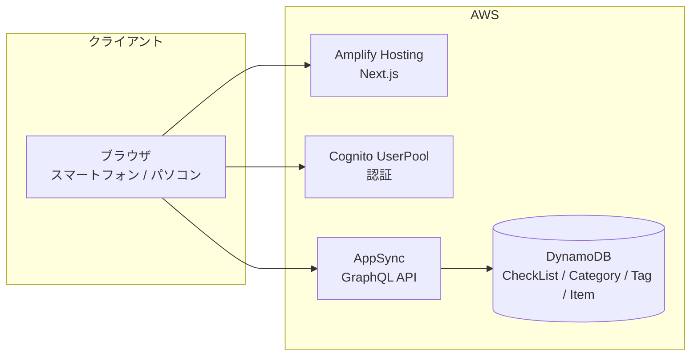
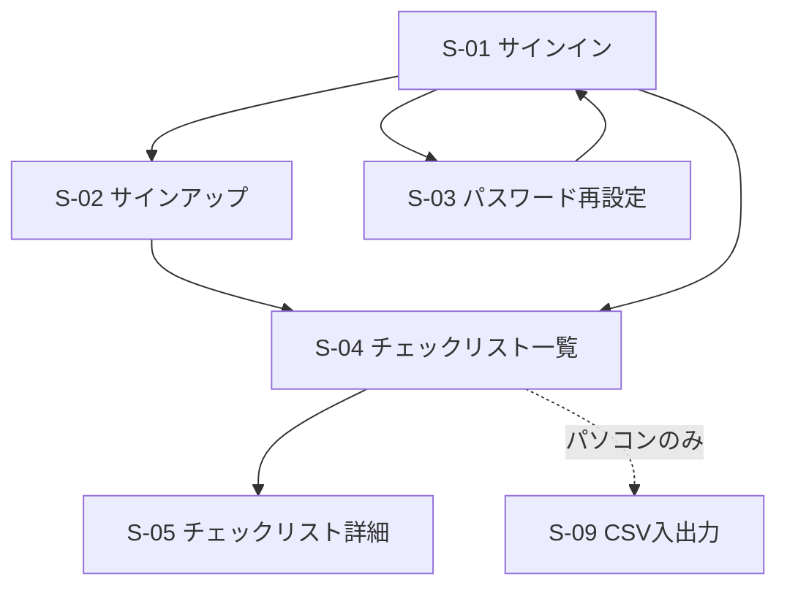
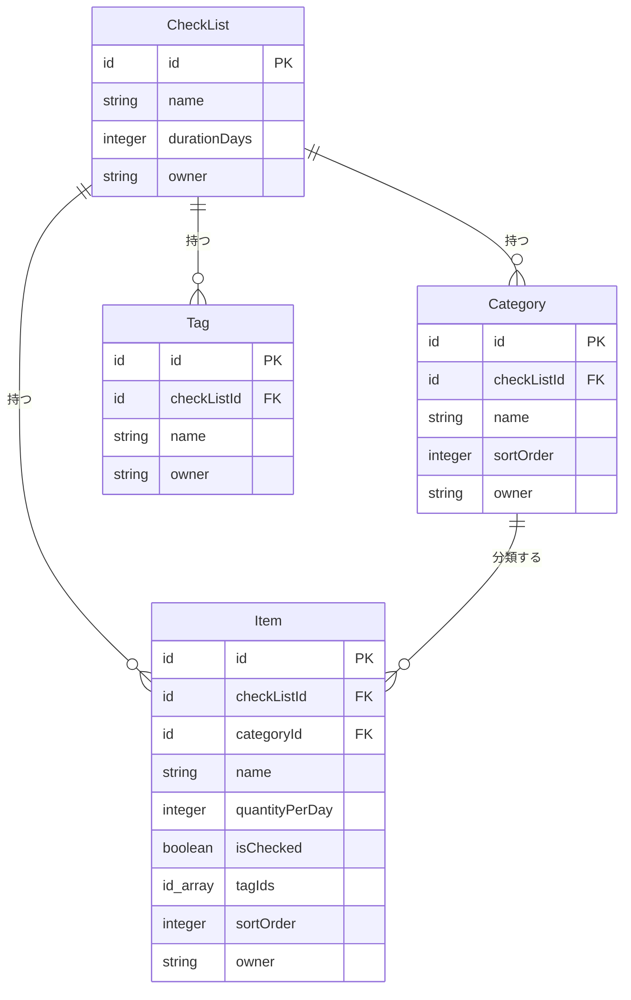

# CheckList 機能設計書

本書は `product-requirements.md`（「何を作るか」）に対する「どう作るか」を定義する。機能ID（F-NN）・画面ID（S-NN）・受け入れ条件ID（AC-NN）は同書を参照する。

## 技術スタック

| レイヤー       | 技術                                                                                   |
| -------------- | -------------------------------------------------------------------------------------- |
| フロントエンド | Next.js 16（App Router）/ React 19 / TypeScript 5                                      |
| UI             | Tailwind CSS 4 / shadcn/ui（Radix UI）/ lucide-react / dnd-kit（ドラッグでの並べ替え） |
| 認証           | Amazon Cognito UserPool（Amplify Auth）                                                |
| API            | AWS AppSync（GraphQL・Amplify Data）                                                   |
| データストア   | Amazon DynamoDB（Amplify Data が生成）                                                 |
| IaC / デプロイ | AWS Amplify Gen 2（CDK）                                                               |
| ホスティング   | AWS Amplify Hosting                                                                    |

テンプレート（Amplify-G2-Template）の構成をそのまま用い、新規の依存パッケージは追加しない。CSVの解析・生成は外部ライブラリを使わず自前実装とする（列数5・区切り文字固定のため）。

## システム構成図

**Lambda関数は定義しない。** 一括処理（一括リセット・一括削除・複製・CSV取り込み）はいずれも複数レコードを順に書き換えるループであり、Lambdaに置いてもAppSync経由の呼び出し回数は変わらない。150件規模ではコールドスタートの分だけ不利になるため、フロントエンドのService層から同時実行数を制限して発行する。

## アーキテクチャレイヤー

`architecture.md` のレイヤー構成に従う。

### フロントエンド

**Component → Hook → Service → Repository → AppSync**

| レイヤー   | 配置先                  | 本プロダクトでの主な責務                                |
| ---------- | ----------------------- | ------------------------------------------------------- |
| Component  | `src/app/components/`   | 画面描画・入力イベント。ロジックを持たない              |
| Hook       | `src/app/hooks/`        | 画面単位の状態保持、Serviceの呼び出し、楽観的更新の制御 |
| Service    | `src/app/services/`     | 数量計算・タグ絞り込み・CSVの生成と解析・入力値の検証   |
| Repository | `src/app/repositories/` | Amplify Data Clientの呼び出しのみ                       |

タグ絞り込み（F-06）と数量計算（F-09）は、詳細画面が保持済みの持ち物配列に対するクライアント側の処理としてServiceに置く。絞り込みのたびにAPIを呼ばない。

### バックエンド

Lambda関数を持たないため、`amplify/` はリソース定義のみとなる。

| 配置先                     | 内容                                                         |
| -------------------------- | ------------------------------------------------------------ |
| `amplify/auth/resource.ts` | Cognito UserPoolの定義                                       |
| `amplify/data/resource.ts` | GraphQLスキーマ（4モデル）の定義                             |
| `amplify/backend.ts`       | バックエンド統合定義・パスワードポリシー・タグ付与           |
| `amplify/common/`          | CDK実行時の環境変数定義。`backend.ts` が環境名の解決に用いる |

`amplify/functions/` は使用しない。フロントエンドとバックエンドで共有するコードは発生しないため、`shared/` と `amplify/tsconfig.json` の `@shared/*` パスエイリアスは削除する。CSV列定義・上限値・数量計算は `src/app/` 配下に置く。

| 配置先              | 内容                                                             |
| ------------------- | ---------------------------------------------------------------- |
| `src/app/enums/`    | CSV列定義、上限値（日数1〜60・数量1〜999・CSV500行）、同時実行数 |
| `src/app/models/`   | CSV行の型、一括処理の結果型                                      |
| `src/app/services/` | 数量計算、CSV生成・解析、一括処理の組み立て                      |

## 画面設計

### ルートパス定義

| 画面ID | ルートパス            | Route Group     | 認証 |
| ------ | --------------------- | --------------- | ---- |
| S-01   | `/sign-in`            | `(public-page)` | 不要 |
| S-02   | `/sign-up`            | `(public-page)` | 不要 |
| S-03   | `/password-reset`     | `(public-page)` | 不要 |
| S-04   | `/lists`              | `(auth-page)`   | 必要 |
| S-05   | `/lists/[listId]`     | `(auth-page)`   | 必要 |
| S-09   | `/lists/[listId]/csv` | `(auth-page)`   | 必要 |

ルート（`/`）は認証状態に応じて `/lists` または `/sign-in` へリダイレクトする。S-06〜S-08は欠番とし、持ち物・カテゴリ・タグの整備はS-05の編集モードで行う。

### 画面遷移図

### レイアウト構成

| 画面       | 構成                                                                                                             |
| ---------- | ---------------------------------------------------------------------------------------------------------------- |
| S-01〜S-03 | 中央寄せ1カラム。カード内にフォームを収める                                                                      |
| S-04       | ヘッダー + チェックリストのカード一覧 + 新規作成ボタン                                                           |
| S-05       | 固定バー（戻る・中央にチェックリスト名と状態表示の2段・操作） + モードごとの本文。下記「詳細画面のモード」を参照 |
| S-09       | ヘッダー + 2カラム（エクスポート / インポート）。狭い画面では1カラムに折り返す                                   |

### 詳細画面のモード

S-05は準備モードと編集モードを同じ画面で切り替える。モードと選択状態は画面内の状態として持ち、URLには出さない。

| モード | 固定バー                                                             | 本文                                                                                                                                                                                                     |
| ------ | -------------------------------------------------------------------- | -------------------------------------------------------------------------------------------------------------------------------------------------------------------------------------------------------- |
| 準備   | 戻る・チェックリスト名／状態表示（残り件数／準備完了）・［編集］     | タグチップ（［タグなし］と各タグ。初期は全選択、選択中は✓付き。画面幅に収まらない分は折り返す）・日数（増減＋直接入力）・チェックを外す・カテゴリ見出しと持ち物行（左に丸のチェック、右端にタグ）        |
| 編集   | ［すべて選択］・チェックリスト名／「編集中・持ち物の件数」・［完了］ | タグチップ（準備モードと共通）・［カテゴリ］［タグ］の管理入口・カテゴリ見出しと持ち物行（左に四角の選択欄、行を押すと編集シート、右端のつまみをドラッグしてカテゴリ内で並べ替え）・カテゴリ末尾の追加欄 |

- 絞り込みの状態は「選択を外したタグのID」と「タグなしを外したか」で持つ。選択中のIDで持たないのは、後から追加したタグを選択された状態で加えるため（AC-03）。状態はチェックリストに保存し（`hiddenTagIds`・`isUntaggedHidden`）、チップを押すたびに書き込む。表示は押した時点で切り替え、書き込みは1件ずつ順に行って最後の状態を保存する（複数端末で同時に操作した場合は後勝ち）。保存時は削除済みのタグのIDを除く。削除の取り消しはタグを新しいIDで作り直すため、選択された状態で戻る
- タグの絞り込みは編集モードにも同じ状態で適用する（FR-05）。編集中に追加した持ち物・タグを変えた持ち物・削除を取り消した持ち物は、チップを切り替えるか［完了］を押すまで絞り込みに関わらず表示する。［すべて選択］と並べ替えは表示中の持ち物が対象。編集シートの［上へ］［下へ］は表示中の隣の持ち物と入れ替え、ドラッグは落とした位置の持ち物の直前（上へ動かした場合）または直後（下へ動かした場合）に入れる。どちらも表示していない持ち物の相対順は変えない。カテゴリをまたぐドラッグはできない
- 持ち物・カテゴリ・タグ・チェックリスト（S-04）は、行の右端または左端のつまみ（≡）をドラッグして並べ替える。表示は落とした時点で切り替える。保存に失敗したら（一部だけ書き込まれている場合があるため）サーバーから読み直し、読み直しにも失敗したら元の並びに戻す。並べ替えると対象の全件の表示順を0からの連番に振り直す
- 準備モードは持ち物が0件のカテゴリを見出しごと隠し、編集モードは空のカテゴリも見出しと追加欄を表示する（AC-03）
- 編集モードで追加した持ち物には、準備モードで選択中のタグを自動で付与しない（AC-02）
- 数量は計算結果のみを表示し、読み上げ用ラベルに「1日N個×M日」を持たせる（AC-04）
- 1件以上選択すると、画面下部に選択件数と［カテゴリ］［タグ］［非表示］［削除］を出す（AC-08）。選択中がすべて非表示なら［非表示］は［表示］になる
- 非表示の持ち物は準備モードではタグの選択に関わらず表示せず、残り件数にも数えない。編集モードでは行を薄くして「非表示」と添える（AC-02）
- 下から出るシートは、持ち物の編集（名前・必要数・カテゴリ・タグ・非表示・並び順・削除）、カテゴリ管理、タグ管理、一括のタグ付与、一括のカテゴリ移動の5種類とする。チェックリスト名の変更とS-09への導線はS-04のメニューに置き、S-05には置かない

### デザイン方針

スマートフォン標準のメモアプリに倣い、白地・罫線なし・カードなしとする。色と文字は次のトークンに限る。

| トークン    | 値        | 用途                                                                                      |
| ----------- | --------- | ----------------------------------------------------------------------------------------- |
| accent      | `#e6ad0a` | チェック済みの丸・追加の印・主ボタンの塗り。上に載せる文字と印は白（`#ffffff`）にそろえる |
| accent-text | `#8a6400` | 文字ボタン・タグの表示・入力例                                                            |
| accent-tint | `#fff8e1` | 編集中の固定バー・選択中のチップ・追加直後の強調                                          |
| text-2      | `#6c6c70` | 件数・数量などの補助文字                                                                  |
| fill        | `#f2f2f7` | 入力欄・未選択のチップ・押したときの背景                                                  |
| danger      | `#d9443a` | 削除の操作とエラー                                                                        |

文字は20px（カテゴリ見出し）・17px（本文・ボタン・固定バーの見出し）・15px（チップ・通知・小さな文字ボタン）・13px（補助）の4段階とする。文言はボタンを「〜を追加／〜を削除／〜を変更」、通知を「〜しました」とし、補足の説明文は原則出さない。

### レスポンシブ方針

Tailwindのブレークポイント `md`（768px）を境界とする。

- `md` 未満: 1カラム。操作対象の押せる範囲は高さ44px以上を確保する（AC-07）
- `md` 以上: S-04はチェックリストを1列に並べる。S-05は最大幅640pxの1カラムを中央に置く
- S-09への導線（S-04のメニュー）は `md` 未満では描画しない（AC-07）。URLを直接開いた場合はパソコンでの利用を促す案内を表示する

### 保存と取り消しの実装方式

- 表示は先に更新し、APIの失敗時に元の値へ戻して通知する（楽観的更新）
- 入力欄はフォーカスが外れた時点（`blur`）またはEnterで保存する。追加欄はEnter後もフォーカスを残し、続けて入力できる
- 削除（持ち物・一括・カテゴリ・タグ）と一括リセットは確認ダイアログを出さずに実行し、画面下部の通知に［元に戻す］を7秒間表示する。［元に戻す］付きの通知は、他の通知で上書きしない
- 新しい［元に戻す］付き通知を出すと、それまでの取り消しは確定し押せなくなる（取り消せるのは直前の1操作のみ）
- 取り消しの方法は「削除の取り消し」節を参照。チェックリストの削除とCSVの取り込みのみ確認ダイアログを用いる

## データモデル定義

### ER図

### テーブル定義

いずれも `amplify/data/resource.ts` の `a.model()` で定義し、`id` `createdAt` `updatedAt` `owner` はAmplify Dataが自動付与する。

#### CheckList（チェックリスト）

| フィールド       | 型      | 必須 | 説明                                                                           |
| ---------------- | ------- | ---- | ------------------------------------------------------------------------------ |
| id               | ID      | ○    | 自動採番                                                                       |
| name             | String  | ○    | チェックリスト名。重複を許容する（FR-01）                                      |
| durationDays     | Integer | ○    | 日数。数量計算の基準。初期値1、範囲1〜60（FR-06）                              |
| hiddenTagIds     | ID配列  | ―    | 準備モードの絞り込みで選択を外したタグのID。未設定は空として扱う（FR-05）      |
| isUntaggedHidden | Boolean | ―    | 準備モードの絞り込みでタグなしを外しているか。未設定はfalseとして扱う（FR-05） |
| sortOrder        | Integer | ―    | 一覧での表示順。小さい順に並べ、未設定は作成日時順で末尾に置く（FR-01）        |

#### Category（カテゴリ）

| フィールド  | 型      | 必須 | 説明                                                 |
| ----------- | ------- | ---- | ---------------------------------------------------- |
| id          | ID      | ○    | 自動採番                                             |
| checkListId | ID      | ○    | 所属チェックリスト。セカンダリインデックスを設定する |
| name        | String  | ○    | カテゴリ名。同一チェックリスト内で一意（FR-03）      |
| sortOrder   | Integer | ○    | 表示順。小さい順に並べる                             |

#### Tag（タグ）

| フィールド  | 型      | 必須 | 説明                                                                  |
| ----------- | ------- | ---- | --------------------------------------------------------------------- |
| id          | ID      | ○    | 自動採番                                                              |
| checkListId | ID      | ○    | 所属チェックリスト。セカンダリインデックスを設定する                  |
| name        | String  | ○    | タグ名。同一チェックリスト内で一意（FR-04）                           |
| sortOrder   | Integer | ―    | 表示順。小さい順に並べ、未設定のタグは作成日時順で末尾に置く（FR-04） |

#### Item（持ち物）

| フィールド     | 型      | 必須 | 説明                                                                                                 |
| -------------- | ------- | ---- | ---------------------------------------------------------------------------------------------------- |
| id             | ID      | ○    | 自動採番。CSVの識別子列に出力する                                                                    |
| checkListId    | ID      | ○    | 所属チェックリスト。セカンダリインデックスを設定する                                                 |
| categoryId     | ID      | ○    | 所属カテゴリ                                                                                         |
| name           | String  | ○    | 持ち物名                                                                                             |
| quantityPerDay | Integer | ―    | 1日あたりの必要数。未設定可。範囲1〜999（FR-02）                                                     |
| isChecked      | Boolean | ○    | 準備状況。初期値false                                                                                |
| tagIds         | ID配列  | ―    | 付与されたタグのID。要素は必須（null を含めない）。空配列は絞り込みの「タグなし」に該当する（FR-05） |
| sortOrder      | Integer | ―    | カテゴリ内の表示順。小さい順に並べ、未設定の持ち物は作成日時順で末尾に置く（FR-02）                  |
| isHidden       | Boolean | ―    | 準備モードで表示しないか。未設定はfalseとして扱う（FR-02）                                           |

### 設計判断

**タグの付与を中間テーブルではなくItemの配列で持つ。** 持ち物とタグは多対多だが、中間テーブルを置かず `Item.tagIds` に保持する。1チェックリストの持ち物は150件規模であり、詳細画面は全件を読み込んで保持するため、絞り込みも件数判定もクライアント側の配列操作で完結する。中間テーブルを持つと、持ち物の作成・更新・削除・CSV同期のすべてで関連レコードの整合維持が必要になり、処理が増える割に得るものがない。

代償として「このタグはどの持ち物に付いているか」の判定にチェックリスト内の持ち物一覧が必要になる。タグ削除の可否判定（AC-11）はこの一覧を用いる。タグ管理シートには付与件数を表示しないため、判定は削除操作時の1回だけで済む。

**持ち物の表示順を任意項目で持つ。** 既存の持ち物には値がないため `Item.sortOrder` は任意とし、未設定は作成日時順で末尾に並べる。追加・一括カテゴリ移動・CSV取り込みでは、対象カテゴリの末尾（最大値＋1）に採番する。並べ替えは隣り合う2件の値を入れ替える（2件の `updateItem`）。いずれの操作でも、対象カテゴリの表示順が0からの連番になっていなければ（未設定・重複・欠番）、先にカテゴリ内の全件へ0からの連番を振り直す（このとき最大値＋1はカテゴリ内の件数と等しい）。

**チェック状態を持ち物自身に持つ。** 外出ごとの履歴を残さない仕様（スコープ外）のため、チェック状態を別テーブルに分離せず `Item.isChecked` とする。

### 認可

全モデルに `allow.owner()` を設定し、所有者以外からの参照・更新を拒否する（FR-09）。Lambdaを持たないため `allow.resource()` による許可は不要で、すべての読み書きが認証済みユーザーの所有者判定を通る。

## API設計

### 標準操作（Amplify Dataが自動生成）

| operation         | 入力                                          | 戻り値        | 対応機能         | 説明                                                           |
| ----------------- | --------------------------------------------- | ------------- | ---------------- | -------------------------------------------------------------- |
| `listCheckLists`  | ―                                             | CheckList配列 | F-01             | 所有者のチェックリスト一覧                                     |
| `getCheckList`    | id                                            | CheckList     | F-01             | 1件取得                                                        |
| `createCheckList` | name, durationDays, sortOrder?                | CheckList     | F-01             | 作成。併せて「未分類」カテゴリを作成する                       |
| `updateCheckList` | id, 変更フィールド                            | CheckList     | F-01, F-06, F-10 | 名称・日数・絞り込みの状態・表示順の更新                       |
| `listCategories`  | checkListId                                   | Category配列  | F-04             | インデックスで絞り込む                                         |
| `createCategory`  | checkListId, name, sortOrder                  | Category      | F-04             | 追加                                                           |
| `updateCategory`  | id, name?, sortOrder?                         | Category      | F-04             | 名称・表示順の更新                                             |
| `deleteCategory`  | id                                            | Category      | F-04             | 持ち物0件かつ最後の1件でないときのみ実行する                   |
| `deleteCheckList` | id                                            | CheckList     | F-01             | 配下を削除したうえで本体を削除する                             |
| `listTags`        | checkListId                                   | Tag配列       | F-05             | インデックスで絞り込む                                         |
| `createTag`       | checkListId, name, sortOrder                  | Tag           | F-05             | 追加                                                           |
| `updateTag`       | id, 変更フィールド                            | Tag           | F-05             | 名称・表示順の更新                                             |
| `deleteTag`       | id                                            | Tag           | F-05             | 付与0件のときのみ実行する                                      |
| `listItems`       | checkListId                                   | Item配列      | F-03             | インデックスで絞り込む                                         |
| `createItem`      | checkListId, categoryId, name, sortOrder ほか | Item          | F-03             | 追加。sortOrderはカテゴリ内の最大値＋1                         |
| `updateItem`      | id, 変更フィールド                            | Item          | F-03, F-07, F-15 | 名称・数量・カテゴリ・タグ・表示順・非表示・チェック状態の更新 |
| `deleteItem`      | id                                            | Item          | F-03             | 1件削除                                                        |

### 一括処理

一括リセット（F-08）・一括操作（F-15）・複製（F-02）・チェックリスト削除（F-01）・CSV取り込み（F-13）は、いずれも標準操作の繰り返しで実現する。専用のGraphQL操作もLambdaも定義しない。

| 処理                   | 組み立て                                                                                                  | 呼び出し件数の目安 |
| ---------------------- | --------------------------------------------------------------------------------------------------------- | ------------------ |
| 一括リセット           | チェック済みの持ち物にのみ `updateItem`（`isChecked: false`）                                             | 〜150              |
| 一括削除               | 選択された持ち物に `deleteItem`                                                                           | 〜150              |
| 一括カテゴリ移動       | 選択された持ち物に `updateItem`（`categoryId`・移動先の末尾の `sortOrder`）                               | 〜150              |
| 一括タグ付与・解除     | 選択された持ち物のうち変化があるものに `updateItem`（`tagIds`）                                           | 〜150              |
| 削除の取り消し         | 削除した持ち物・カテゴリ・タグを同じ内容で `create*` し直す                                               | 〜150              |
| 一括リセットの取り消し | 外す前にチェック済みだった持ち物に `updateItem`（`isChecked: true`）                                      | 〜150              |
| 並び順の振り直し       | 表示順が未設定・重複のカテゴリ内の全件に `updateItem`（`sortOrder`）                                      | 〜カテゴリ内件数   |
| 複製                   | `createCheckList` → カテゴリ・タグを作成 → 持ち物を作成（表示順を引き継ぐ）                               | 〜160              |
| チェックリスト削除     | 持ち物 → タグ → カテゴリ → 本体の順に削除                                                                 | 〜160              |
| CSV取り込み            | 差分を求めたうえで `createItem` / `updateItem` / `deleteItem`。新規行はカテゴリの末尾に行順で表示順を振る | 〜200              |

実装方針は次のとおり。

- **同時実行数を10に制限した並列実行**で発行する。上限値は `src/app/enums/` に定数として置く
- **差分のみを更新する。** 一括リセットは既にチェック済みの持ち物だけを対象にし、CSV取り込みは内容が変わらない行を呼び出しから除く
- **ロールバックしない。** 途中で失敗しても成功分はそのまま残し、成功件数と失敗件数を利用者に示す
- **冪等に設計する。** 再実行しても結果が変わらないようにする（リセットは未チェックへの上書き、削除は対象が存在しない場合も成功扱い）
- **進行状況を画面に出す。** 件数の多い処理は進捗と完了を示し、完了までは同じ操作を再実行できないようにする

処理の途中でブラウザを閉じると中断され、一部だけが反映された状態になる。上記のとおり各処理は冪等であり、同じ操作をやり直せば整合する状態に復帰できる。

### CSV取り込みの差分算出

CSVの解析・既存データとの突き合わせ・確認画面用の集計は、すべてフロントエンドのServiceで行う。確認画面（AC-09）の表示時点では書き込みを行わず、次の分類のみを算出する。

| 区分     | 判定                                                     |
| -------- | -------------------------------------------------------- |
| 新規     | 識別子の列が空欄の行                                     |
| 更新     | 識別子が既存の持ち物と一致し、内容に差がある行           |
| 変更なし | 識別子が一致し、内容にも差がない行（呼び出しを行わない） |
| 削除     | CSVに現れなかった既存の持ち物                            |
| 失敗     | 形式不備の行。行番号と理由を保持する                     |

形式不備で除外された行に対応する既存の持ち物は削除対象から外す（FR-10）。

## Lambda関数一覧

Lambda関数は定義しない。

テンプレートに含まれるサンプル関数（`ckl-say-hello` / `ckl-aggregate-access`）とサンプルモデル（`Todo` / `DailyAccessSummary`）、およびそれらに紐づく `amplify/functions/`・`shared/` の各ファイルは本プロダクトで使用しないため削除する。`amplify/common/` は `backend.ts` の環境名解決に用いるため残す。

CSVエクスポート（F-14）も同様にサーバー側の処理を設けない。画面が保持済みの持ち物からフロントエンドのServiceで文字列を生成し、ブラウザでダウンロードする。

## CSV仕様

| 項目       | 内容                                                              |
| ---------- | ----------------------------------------------------------------- |
| 文字コード | UTF-8（BOM付き）。表計算ソフトで開いた際の文字化けを防ぐ（AC-09） |
| 改行       | CRLF                                                              |
| 区切り     | カンマ。値にカンマ・改行・引用符を含む場合はダブルクォートで囲む  |
| ヘッダー行 | 必須。`識別子,カテゴリ,持ち物名,1日あたり,タグ`                   |
| タグ列     | セミコロン区切りで複数指定（例: `国内;海外;帰省`）                |
| 行数上限   | 500行（非機能要件の検証項目）                                     |
| ファイル名 | `checklist_{チェックリスト名}_{YYYYMMDD}.csv`                     |

### 列定義

| 列        | 対応フィールド        | 取り込み時の扱い                                                  |
| --------- | --------------------- | ----------------------------------------------------------------- |
| 識別子    | `Item.id`             | 一致する持ち物を更新。空欄は新規登録。CSVに現れなかった既存は削除 |
| カテゴリ  | `Category.name`       | 未登録の名称は新規作成する                                        |
| 持ち物名  | `Item.name`           | 必須。空欄の行は取り込まない                                      |
| 1日あたり | `Item.quantityPerDay` | 空欄は数量なし。正の整数（1〜999）以外の値は取り込まない          |
| タグ      | `Item.tagIds`         | 名称で突き合わせ、未登録の名称は新規作成する                      |

## 認証設計

| 項目               | 内容                                                                     |
| ------------------ | ------------------------------------------------------------------------ |
| 認証基盤           | Cognito UserPool。`amplify/auth/resource.ts` の `loginWith.email` を使う |
| サインアップ       | メールアドレスとパスワードで登録し、確認コードで本人確認する（AC-06）    |
| パスワードポリシー | 8文字以上・数字と記号を含む（`backend.ts` の既存設定をそのまま用いる）   |
| パスワード再設定   | 確認コードによる再設定（`resetPassword` / `confirmResetPassword`）       |
| セッション         | Amplify標準のトークン管理。ブラウザを閉じても維持される                  |
| 認証状態による制御 | `(auth-page)` 配下は未認証時に `/sign-in` へリダイレクトする             |

家族間での共有は、登録済みアカウントの認証情報を共有する運用で実現する（BR-01）。アプリ側に共有のための機能は設けない。

## バッチ処理・Webhook設計

定期実行処理および外部サービスからの通知受信は定義しない（`product-requirements.md` のバッチ処理・Webhook一覧を参照）。

## 外部API連携

外部APIとの連携は行わない。

## 削除・整合性の扱い

| 操作                   | 挙動                                                                                                                                                                                                                                                                                                      |
| ---------------------- | --------------------------------------------------------------------------------------------------------------------------------------------------------------------------------------------------------------------------------------------------------------------------------------------------------- |
| カテゴリ削除           | 所属する持ち物が1件でもあれば拒否する。チェックリストに残る最後の1件も拒否する。判定は持ち物一覧とカテゴリ一覧から行う（AC-10・FR-03）                                                                                                                                                                    |
| タグ削除               | 付与された持ち物が1件でもあれば拒否する。判定は持ち物一覧から行う（AC-11）                                                                                                                                                                                                                                |
| 持ち物削除             | 単体削除・一括削除ともに関連レコードなし                                                                                                                                                                                                                                                                  |
| 削除の取り消し         | 削除した持ち物は同じ内容（チェック状態・タグ・表示順を含む）で作り直す。IDは新しくなるため、取り消し前に出力したCSVの識別子とは一致しない。持ち物の削除後にその所属カテゴリやタグを削除してから取り消した場合は、所属カテゴリが存在しなければ表示順で先頭のカテゴリへ入れ、存在しないタグは外して作り直す |
| 一括リセットの取り消し | 外したチェックを、外す前にチェック済みだった持ち物にだけ付け直す                                                                                                                                                                                                                                          |
| チェックリスト削除     | 持ち物 → タグ → カテゴリ → 本体の順に削除する                                                                                                                                                                                                                                                             |
| CSV同期での削除        | 形式不備で除外された行に対応する持ち物は削除しない（FR-10）                                                                                                                                                                                                                                               |

参照整合性はデータストア側で保証されないため、上記の判定はいずれもフロントエンドのService層で行う。
